<p align="center"></p>

<p align="center">
<a href="https://github.com/RyanMugele/KugzyJobs-Hiring-Project/actions/workflows/tests.yml"></a>


<a href="LICENSE"></a>
</p>

<p align="center"><strong>A focused hiring workflow for content creators and video editors.</strong><br>
Post a brief. Review portfolios. Compare matches. Select an editor. Collaborate through delivery.</p>

<p align="center">
<a href="#about">About</a> · <a href="#screenshots">Screenshots</a> · <a href="#architecture">Architecture</a> · <a href="#matching">Matching</a> · <a href="#database">Database</a> · <a href="#getting-started">Getting started</a> · <a href="#quality">Quality</a> · <a href="#deployment">Deployment</a> · <a href="#documentation">Documentation</a>
</p>

> **Release status:** source update published and GitHub Actions passed on Linux on 23 November 2026. Render deployment is in progress; a public deployment URL has not yet been verified. Payments and outgoing email remain disabled.

<a id="about"></a>
## What is KugzyJobs?

KugzyJobs is a Flask final-year project by **Ryan Wesly Mugele, Strathmore University**. It brings job posting, portfolio review, applicant comparison and delivery into one place. Its rule-based NLP identifies editing skills, styles and niches in a job brief and makes the compatibility calculation inspectable.

| For creators | For editors | For administrators |
| --- | --- | --- |
| Post and manage editing jobs | Build a linked video portfolio | Approve or reject portfolio evidence |
| Compare applicants and requirement overlap | Apply with a proposal, rate and timeline | Manage users and review reports |
| Select an editor and review delivery | Submit the selected job's deliverable URL | Support account recovery |
| Exchange messages and rate completed work | View applications and feedback | Maintain platform moderation |

**Portfolio verification is a manual review record.** It does not establish copyright ownership or perform plagiarism detection. Editors can apply without verified status; verification supports discovery and portfolio credibility.

<a id="screenshots"></a>
## See the workflow

Screenshots below are genuine local browser captures using fictional demonstration accounts.

<table>
<tr><td width="50%"><strong>Creator workspace</strong><br>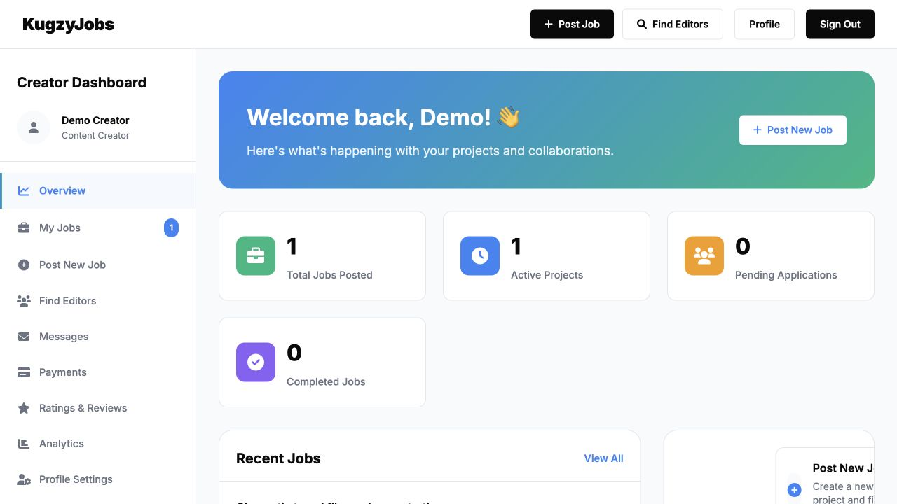</td><td width="50%"><strong>Job details</strong><br>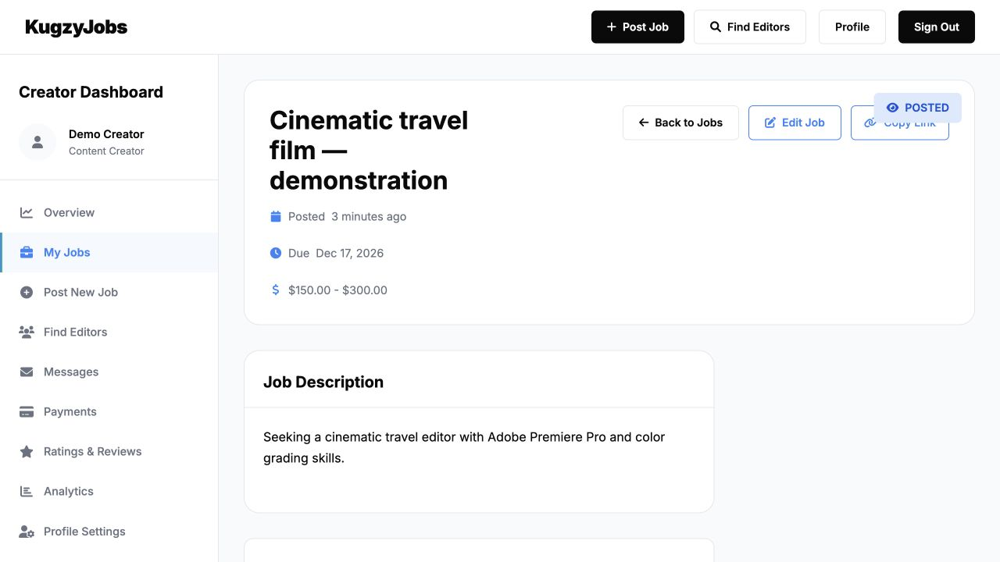</td></tr>
<tr><td><strong>Editor workspace</strong><br>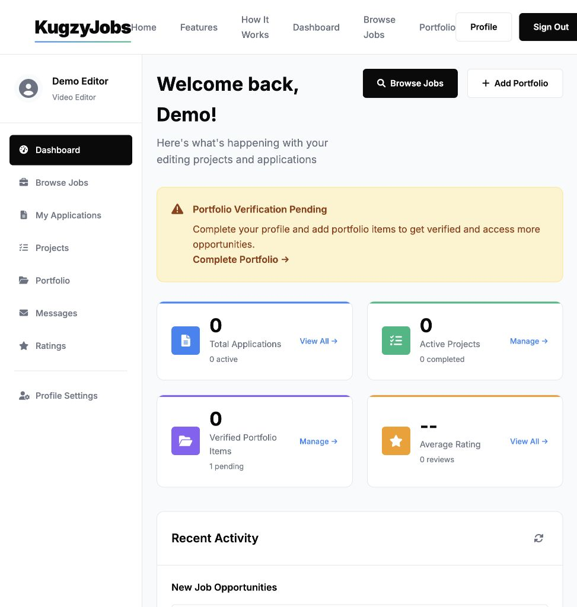</td><td><strong>Application submitted</strong><br>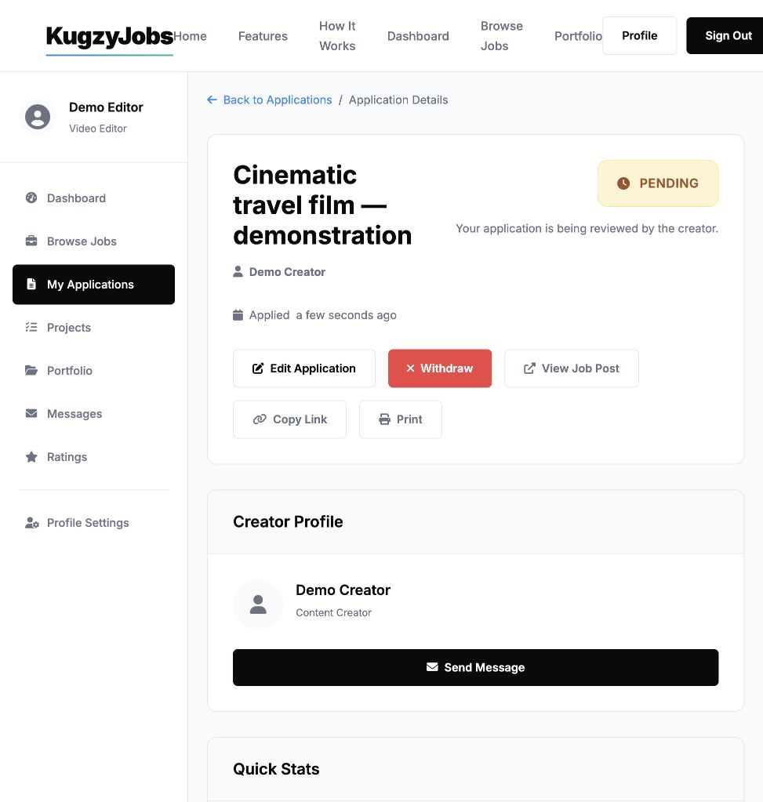</td></tr>
</table>

<a id="architecture"></a>
## Application architecture

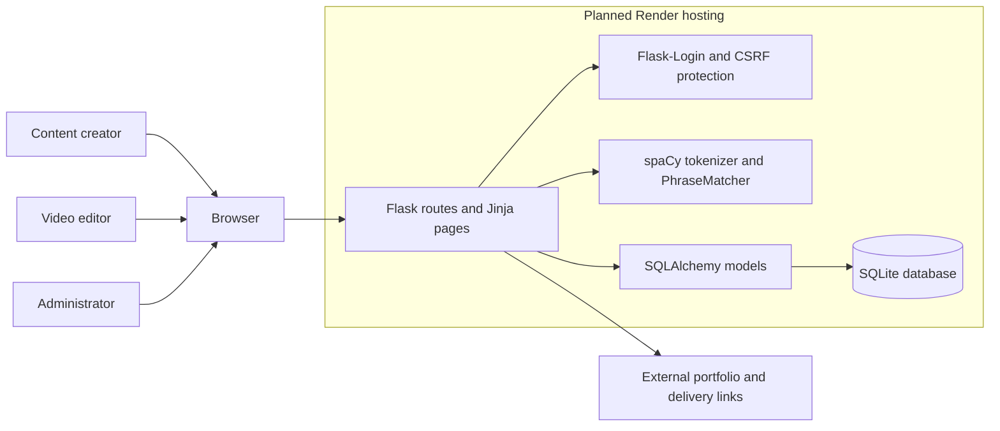

| Layer | Implementation |
| --- | --- |
| User interface | Jinja templates, HTML, CSS and JavaScript |
| Application | Flask application factory and five blueprints |
| Identity and forms | Flask-Login, Werkzeug password hashes, Flask-WTF |
| Data | SQLAlchemy and SQLite; persistent disk configured for Render |
| Requirement extraction | spaCy blank-English tokenizer and PhraseMatcher |
| Production process | Gunicorn; one worker for the small SQLite deployment |
| Verification | pytest workflows, NLP evaluation scripts, GitHub Actions configuration |

### From brief to completion

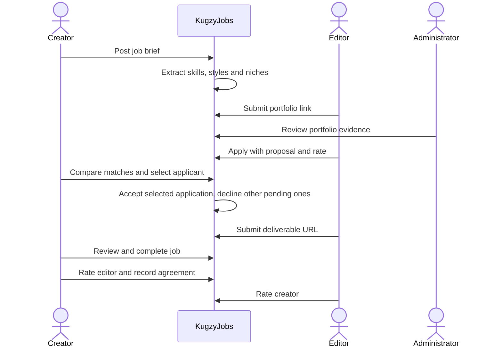

<a id="matching"></a>
## Explainable requirement matching

The system recognizes a curated vocabulary of software, editing skills, styles and content niches. It normalizes aliases, prioritizes longer phrases and avoids reusing matched token spans. It stores extracted categories with the job and refreshes them on edits.

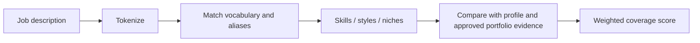

**Score = 50% skills + 25% styles + 25% niches.** Each category measures the fraction of recognized job requirements present in editor evidence. Categories without job requirements are omitted and the remaining weights are normalized. A brief with no recognized requirements scores zero.

This is a descriptive overlap score, not a probability of success, a trained semantic model or a measure of editing ability. Negation and unfamiliar phrasing remain limitations.

| Evaluation | Recorded result | Interpretation |
| --- | --- | --- |
| 20-case test | 18/20 exact matches; precision 100%; recall 96.30%; F1 98.11% | Two cases involving “documentary editor” missed a style label |
| Included CSV | 15 descriptions, with no extraction errors in that evaluation | Small curated dataset; not an independent generalization test |

Evidence: [NLP test log](documentation/nlp-accuracy.txt) · [CSV evaluation log](documentation/nlp-evaluation.txt) · [evaluation dataset](data/evaluation/nlp_test_dataset.csv). These results describe extraction on the included examples, not hiring outcomes.

<a id="database"></a>
## Data model

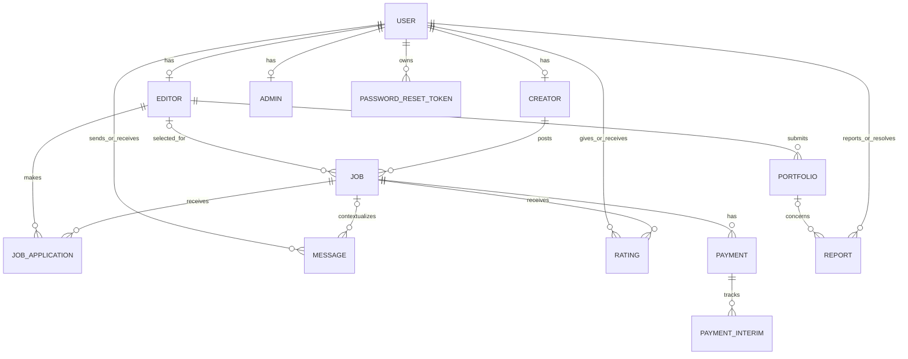

<details>
<summary><strong>Explore all 13 tables</strong></summary>

| Table | Responsibility |
| --- | --- |
| `user` | Identity, password hash, role and rating summary |
| `creator` | Creator profile linked to a user |
| `editor` | Editing profile, skills and verification state |
| `admin` | Administrator profile |
| `job` | Brief, extracted requirements, selected editor and delivery |
| `portfolio` | Editor evidence URL and review outcome |
| `job_application` | Proposal, proposed rate, timeline and decision |
| `message` | Sender, recipient and optional job context |
| `rating` | Completed-job feedback between participants |
| `payment` | Local agreement and invoice records |
| `payment_interim` | Retained gateway integration records; charging disabled |
| `report` | Moderation report and resolution |
| `password_reset_token` | Expiring one-use account recovery token |

The diagram shows permitted foreign-key relationships; application rules add constraints. `init-db` creates missing tables and does not migrate an existing schema. See the model classes in [app/models](app/models) for the authoritative schema.
</details>

### How the creator selects an applicant

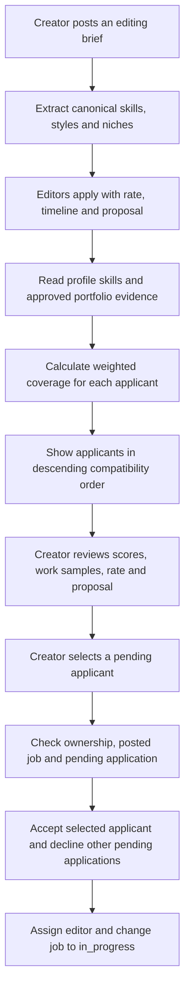

The score supports comparison; **the highest-scoring applicant is not selected automatically**. The creator can choose a lower-scoring applicant after reviewing other considerations. Pending or rejected portfolios do not add matching evidence. Profile skills can still contribute without verified status.

For the tested brief **“Cinematic travel editing in Premiere Pro with color grading”**, the parser returned two skills (`Adobe Premiere Pro`, `Color Grading`), one style (`cinematic`) and one niche (`travel`).

| Test applicant | Skill coverage | Style coverage | Niche coverage | Calculated score |
| --- | --- | --- | --- | --- |
| Editor B | 2/2 | 1/1 | 1/1 | 100% |
| Editor A | 1/2 | 1/1 | 1/1 | 75% |

Editor A's score is `100 × (0.50 × 1/2 + 0.25 × 1 + 0.25 × 1) = 75%`. The test confirmed B appeared first, neither applicant was automatically assigned, and the creator could deliberately select A. A became accepted, B became declined, and the job became `in_progress`. A later selection attempt could not replace A.

### Real system screenshots of different matches

These are captures from the running application on **18 November 2026**, using four fictional profiles and an isolated local database. Applicant cards are cropped from full-page screenshots; their scores and statuses are unchanged.

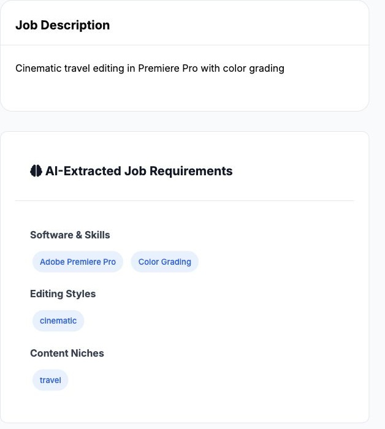

| Editor | Travel brief | Gaming brief | Why the result changes |
| --- | --- | --- | --- |
| Alex Full Match | 100% | 0% | Premiere Pro and Color Grading plus approved cinematic/travel evidence |
| Blair Partial Match | 75% | 0% | Premiere Pro and cinematic/travel evidence; Color Grading missing |
| Drew Profile Skills | 25% | 0% | One of two profile skills; no approved portfolio style or niche evidence |
| Casey Gaming Editor | 0% | 100% | CapCut plus approved fast-paced/gaming evidence |

<table>
<tr><td width="50%"><strong>Full match — 100%</strong><br>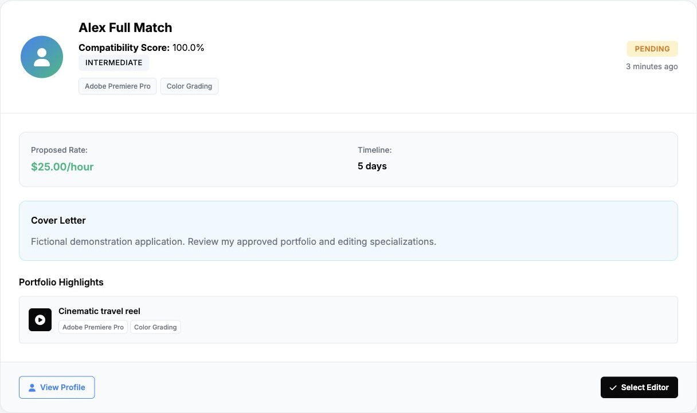</td><td width="50%"><strong>Partial match — 75%</strong><br>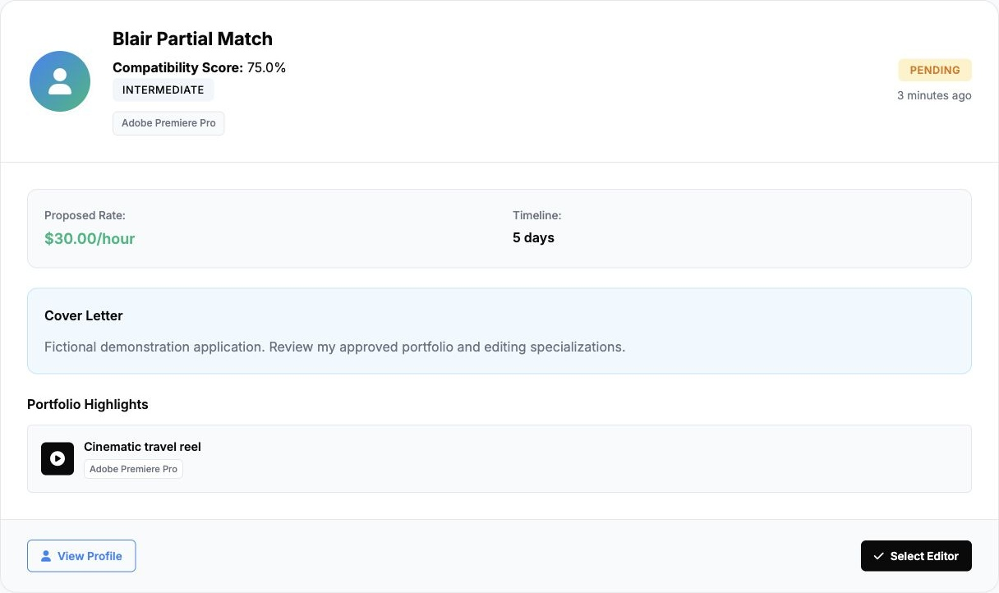</td></tr>
<tr><td><strong>Profile skill only — 25%</strong><br>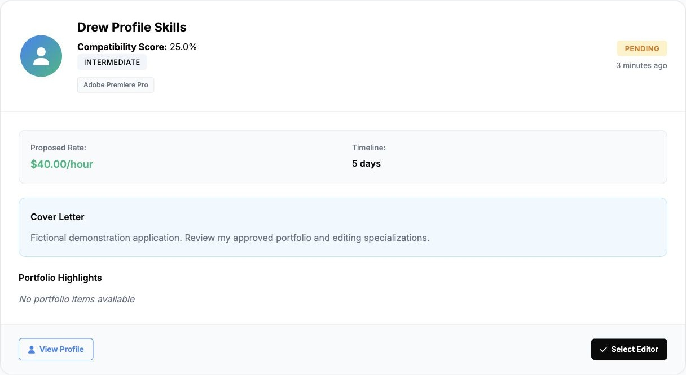</td><td><strong>Unrelated evidence — 0%</strong><br>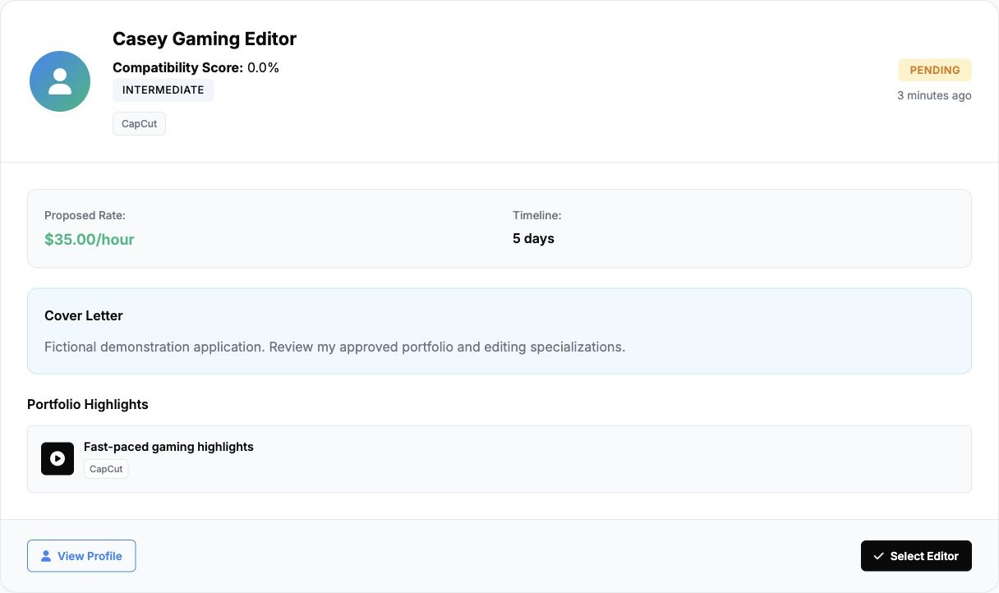</td></tr>
</table>

**Changing the brief changes the best match.** For “Fast-paced gaming editing in CapCut”, Casey scores 100%, while the other three applicants score 0%.

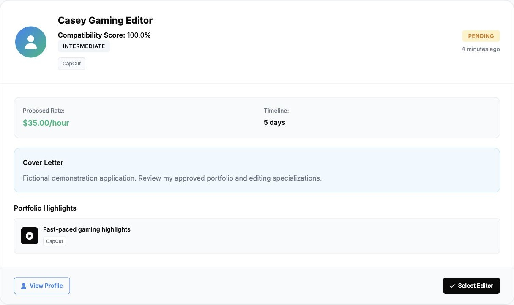

**The creator still decides.** The browser walkthrough deliberately selected Blair at 75% for the travel job. The resulting screen shows the job in progress, Blair selected, one application accepted and three declined.

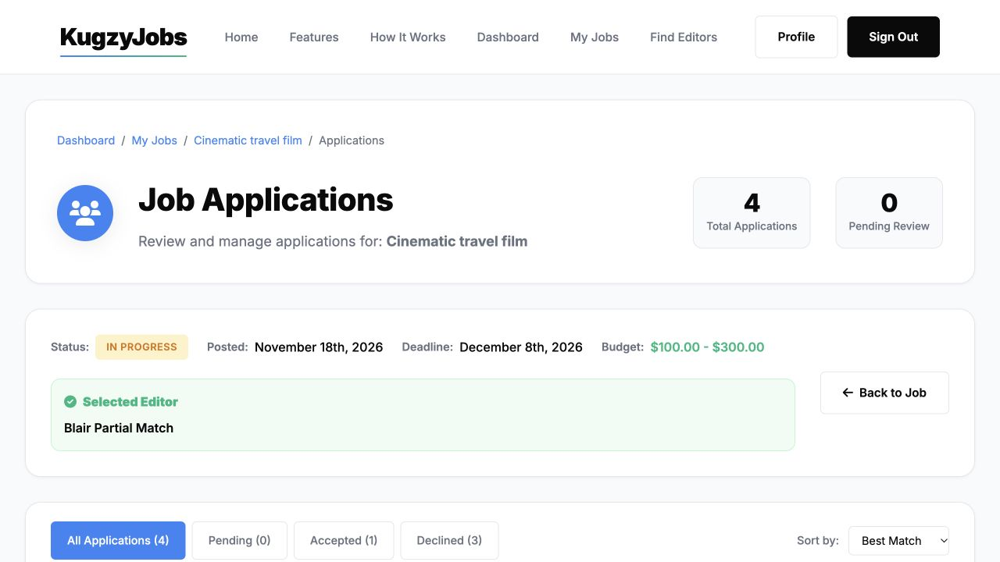

[Capture details and source screenshots](documentation/MATCHING_SCREENSHOTS.md).

**Focused results:** 11 tests passed, covering score examples, normalization, ranking, evidence eligibility, selection and access safeguards. [Detailed results and reproduction](documentation/SELECTION_MATCHER_TESTS.md) · [raw test log](documentation/selection-matcher-tests.txt).

### Access and safeguards

Sessions resolve the base user ID and check the stored role. State-changing forms use CSRF tokens. Suspended accounts cannot keep accessing protected pages. Job selection, delivery, messages and ratings check ownership or participant eligibility. Public administrator registration is disabled. Recovery tokens expire and cannot be reused. Review protection prevents an approved portfolio item from being silently replaced.

<a id="getting-started"></a>
## Getting started

**Requirements:** Python 3.14, a browser and internet access for dependency installation. Python 3.14.0 on macOS was used for the local verification.

```sh
git clone https://github.com/RyanMugele/KugzyJobs-Hiring-Project.git
cd KugzyJobs-Hiring-Project
python3 -m venv .venv
source .venv/bin/activate
python -m pip install -r requirements-lock.txt
cp .env.example .env
```

Generate a secret with `python -c 'import secrets; print(secrets.token_hex(32))'`, then replace the example `SECRET_KEY` in your private `.env`. Keep `FLASK_CONFIG=development` for local use.

```sh
python -m flask --app flasky init-db
python -m flask --app flasky run --host 127.0.0.1 --port 5001
```

Open **http://127.0.0.1:5001**. On Windows, activate with `.venv\Scripts\activate` instead. The included macOS `Start KugzyJobs.command` also handles local setup.

### Administrator and optional demo

```sh
python create_admin.py
# Local fictional demonstration data only:
python seed_demo.py
```

Both scripts prompt for credentials; use a password of at least 12 characters. Demo accounts use reserved example addresses and placeholder portfolio links. Do not seed demo users on the public service. `.env`, databases, uploaded role images and local environments are excluded from Git.

<a id="quality"></a>
## Quality and evidence

```sh
python -m pip install -r requirements-dev.txt
python -m pytest
python test_nlp_accuracy.py
python evaluate_nlp.py
```

| Check | Recorded evidence |
| --- | --- |
| Full release suite | Latest run: 49 passed, including 11 focused matcher/selection cases; see [test log](documentation/deployment-tests.txt) |
| Production preparation | See [deployment verification](documentation/DEPLOYMENT_VERIFICATION.md) for the latest results |
| GET route inventory | 91 routes sampled; no unhandled exceptions in the recorded audit |
| NLP | 20-case extraction test and 15-description CSV evaluation |
| Browser walkthrough | Creator/editor login, job and application flow; screenshots above |
| CI | [Workflow configured](.github/workflows/tests.yml); hosted Linux run passed on 23 November 2026 |

Tests use separate temporary databases. `pytest.ini` deliberately collects `tests/`; some historical root scripts expect a pre-existing development database. The recorded dependency audit applies to the original runtime lock at its audit date; it does not certify the new production dependency or public deployment.

<a id="deployment"></a>
## Deployment

[Render deployment guide](documentation/DEPLOYMENT.md) · [service configuration](render.yaml) · [release checklist](documentation/RELEASE_CHECKLIST.md)

The prepared service uses HTTPS, Gunicorn, secure cookies, a database readiness endpoint and a paid persistent disk. Automatic deployment is off so a push does not immediately publish app changes. The proposed small-instance setup uses one worker and one service; load and concurrency capacity have not been established.

**Live URL:** pending approved deployment. No domain or successful deployment is claimed yet.

### Scope and limitations

- Payments and outgoing email are disabled. Agreements and invoices are local records and do not transfer money.
- Portfolio and delivery media are external URLs; KugzyJobs does not host video files.
- Manual verification does not prove authorship. Vocabulary matching has known language limitations.
- Social sign-in buttons and some informational links remain placeholders.
- Real email delivery, live gateway settlement, large-scale performance and production Linux behavior still need separate verification.

## Repository layout

```text
KugzyJobs-Hiring-Project/
├── app/
│   ├── authentication/          # Registration, login and recovery
│   ├── creator/                 # Jobs, applicants and creator workspace
│   ├── editor/                  # Portfolio, applications and delivery
│   ├── admin/                   # Reviews, users and moderation
│   ├── main/                    # Public pages
│   ├── models/                  # SQLAlchemy entities
│   ├── nlp/                     # Vocabulary and matching logic
│   ├── templates/               # Jinja pages
│   └── static/                  # Shared visual assets
├── utilities/                   # Authentication, files and service helpers
├── data/                        # NLP samples and evaluation results
├── tests/                       # Repeatable workflow/security tests
├── documentation/               # Architecture, evidence and deployment
├── .github/workflows/tests.yml  # CI configuration
├── config.py                    # Development, test and production settings
├── flasky.py                    # Application entry point and init-db command
├── render.yaml                  # Paid Render service and disk
└── start-production.sh           # Initialize missing tables and run Gunicorn
```

<a id="documentation"></a>
## Documentation

| Guide | Contents |
| --- | --- |
| [Architecture](documentation/ARCHITECTURE.md) | Application boundaries and end-to-end workflow |
| [Test report](documentation/TEST_REPORT.md) | Original audit results and test limitations |
| [Changes](documentation/CHANGES.md) | Corrections made during the local audit |
| [Deployment](documentation/DEPLOYMENT.md) | Hosting configuration, administrator setup and backup |
| [Deployment verification](documentation/DEPLOYMENT_VERIFICATION.md) | Checks on this prepared release |
| [Release checklist](documentation/RELEASE_CHECKLIST.md) | Remaining publication and live verification steps |

<p align="center"><strong>Built by Ryan Wesly Mugele</strong><br>Strathmore University · Final-year project<br><a href="https://github.com/RyanMugele">GitHub</a> · <a href="LICENSE">MIT License</a></p>
