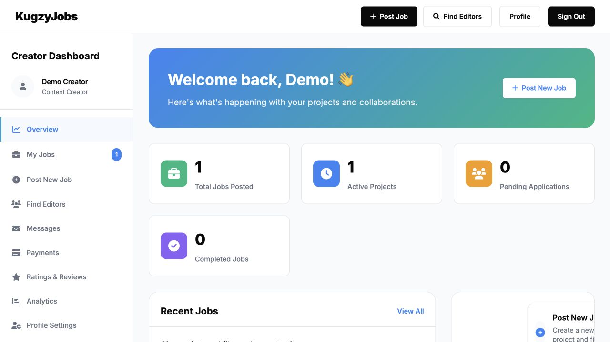
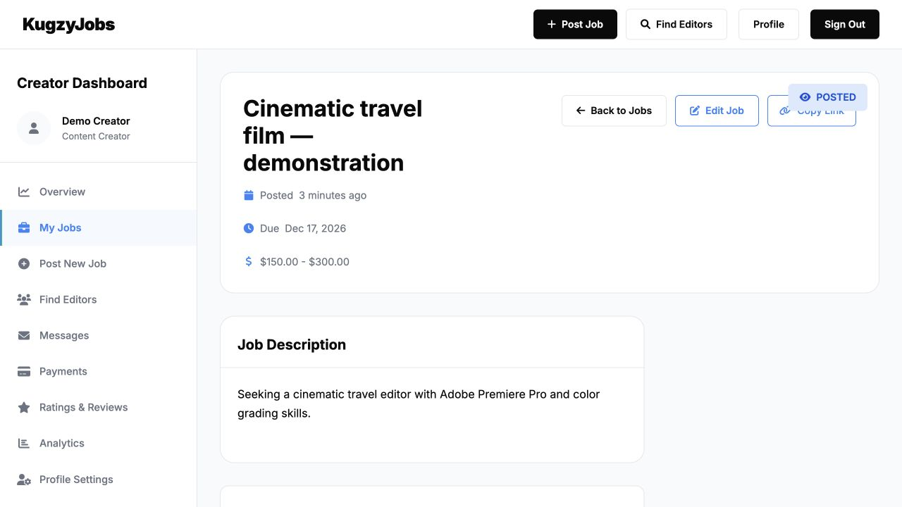
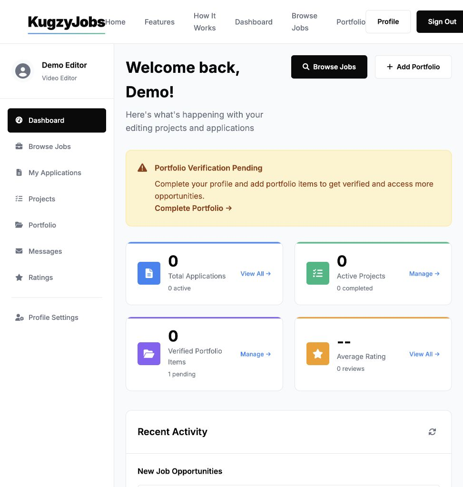

# Chapter 5: Implementation and Evaluation

## 5.1 Introduction

KugzyJobs implements a web-based workflow connecting content creators and freelance video editors. This chapter describes the implementation and the tests executed on the audited local demonstration release on November 17, 2026. The evaluation uses fictional users and isolated test data. It does not represent a production deployment or a study involving real users.

## 5.2 Implementation environment

The application uses Python 3.14.0, Flask, SQLAlchemy, Flask-Login, Flask-WTF, Jinja2, SQLite, and spaCy. A Flask application factory registers separate authentication, creator, editor, administrator, and public blueprints. Model relationships connect users to role-specific profiles, jobs, applications, portfolios, messages, ratings, reports, and payment agreements. The release includes exact dependency versions, a local launcher, and repeatable tests.

## 5.3 Implemented workflows

Creators can register, sign in, publish jobs, inspect extracted job requirements, browse editors, and review applicant compatibility. Editors can maintain profile and portfolio information, apply to jobs, and manage assigned projects. Administrators approve or reject portfolio evidence and review user reports. Selecting an applicant assigns an editor and changes the job from posted to in progress. The editor provides a deliverable URL; the creator reviews the work and completes the job. Participants can then exchange ratings and record a payment agreement.

Messages are stored within the application. Job-linked messages validate that the participants are the creator and an applicant. Ratings are restricted to the actual creator and selected editor after completion. Approved portfolios cannot be edited. Pending or rejected portfolio edits require review; deleting the last approved portfolio removes the editor’s verified status.

## 5.4 NLP implementation

The NLP component uses a blank English spaCy tokenizer and PhraseMatcher with a defined vocabulary. It recognizes software names, skills, editing styles, and content niches, normalizes aliases, and stores canonical values. Matching compares required terms against editor profile skills and approved portfolio evidence. Skills contribute 50% of the available weight; styles and niches each contribute 25%. Missing requirement categories are excluded from the denominator.

This is rule-based NLP. It does not train a model, infer portfolio authorship, or establish an applicant's actual competence. The compatibility score is a descriptive overlap measure and should support human review.

## 5.5 Functional and security evaluation

The automated tests exercise registration, actual password login, role-specific pages, job creation, portfolio submission and approval, applications, editor selection, deliverable submission, job completion, messaging, ratings, and a payment agreement. Negative tests cover missing CSRF tokens, cross-account job edits, suspended sessions, administrator signup, unsafe redirect targets, unrelated job messages, unrelated ratings, duplicate ratings, token expiry and reuse, blocked edits to approved evidence and verification removal on deletion, and selecting an editor without an application.

Tests use an in-memory SQLite database with synthetic records. The exact final count and raw output are supplied in `TEST_REPORT.md` and `test-results.txt`. The separate page smoke check records HTTP responses and exceptions; a redirect can be expected for inaccessible states and is not automatically proof that a workflow passed.

The browser check separately confirmed creator and editor sign-in and an application submission with an observed success page. Figures 5.1–5.4 are genuine browser captures using fictional demonstration data.

## 5.6 NLP evaluation results

The existing 20-case extraction script produced 18 exact case matches (90%). Overall precision was 100%, recall 96.30%, and F1 98.11%. Skill and niche F1 were 100%; style F1 was 92.31%. Both missed exact matches involved the phrase “documentary editor”: the parser treats it as a niche and suppresses the documentary style, while those test cases expect the style.

The separate included CSV evaluation reported 100% precision, recall, and F1 for all three categories, with 17 skill, 12 style, and 13 niche true positives. These results come from different supplied test sets. They should be reported separately and do not establish performance on unseen real job postings. Vocabulary and small curated examples can make evaluation optimistic.

## 5.7 Security changes and operational boundaries

The audit corrected user-ID/role-ID confusion, suspended-account access, predictable administrator signup configuration, password-reset execution, missing CSRF protection on mutation routes, unauthorized ratings, stale portfolio approvals, and incomplete form pages. Passwords use Werkzeug hashing. Tokens have expiry and one-use handling. Production configuration requires a secret and secure cookies.

No real payment or email was sent. Outgoing email and Pesapal requests remain disabled. Payment agreements and invoices are local records; they do not demonstrate settlement or escrow. The delivered release includes a dependency scan report, but an advisory scan is not a penetration test or proof that the application is secure.

## 5.8 Evaluation limitations

No independent usability study, load test, live MySQL test, production deployment assessment, plagiarism detection, email delivery test, or provider reconciliation test was performed. Deliverables are externally hosted links. Fonts/icons may require connectivity. Some informational links and external sign-in controls are placeholders. Historic root test scripts may require a populated development database; the repeatable automated suite is isolated under `tests/`.

# Chapter 6: Conclusions and Recommendations

## 6.1 Conclusion

The audited demonstration supports the central hiring workflow from job publication to delivery review and participant ratings. Role-specific interfaces and administrator portfolio review provide a workable foundation for a specialized video-editor hiring prototype. Rule-based NLP converts familiar editing terminology into structured requirements and supports explainable applicant comparisons.

The audit improved local reproducibility and repaired failures in authentication, forms, authorization, portfolio review state, and workflow rendering. The evidence supports a local academic demonstration within the tested scope. It does not justify claims of production readiness, verified authorship, real payment completion, or market adoption.

## 6.2 Contribution

The project brings job postings, editor profiles, portfolio review, applications, project states, messaging, ratings, and transparent requirement matching into one Flask application. Its separation into blueprints and models supports future maintenance, while the automated suite and recorded test results make key behavior repeatable and reviewable.

## 6.3 Recommendations

Future work should prioritize provider sandbox testing, amount/currency/reference reconciliation, idempotent payment callbacks, and a complete operational payment model before enabling transactions. Email recovery needs configured delivery, abuse prevention, and monitored failure handling. Production deployment should add rate limits, durable storage policies, backups, schema migrations, concurrency checks, and independent security testing.

Portfolio assurance could be strengthened through provenance evidence and structured reviewer criteria. NLP should be evaluated on an independently collected dataset with explicit annotation rules, including negation, overlapping style/niche labels, ambiguous descriptions, and new terminology. User evaluation should measure task completion and usability with consented participants rather than relying on synthetic data.

## 6.4 Final observation

KugzyJobs demonstrates the feasibility of an integrated creator–editor hiring workflow. Its strongest next step is to validate the remaining external integrations and broaden independent evaluation while retaining clear boundaries between implemented behavior, measured results, and future features.
